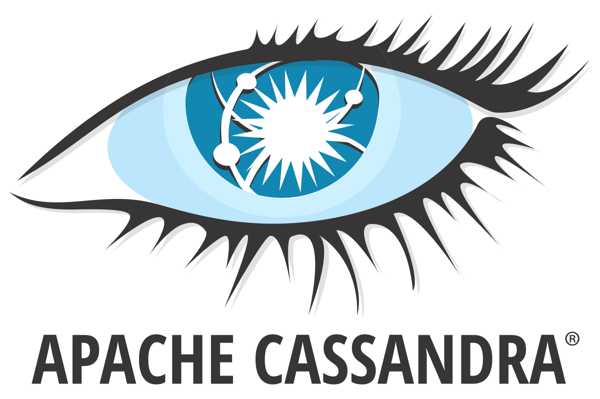
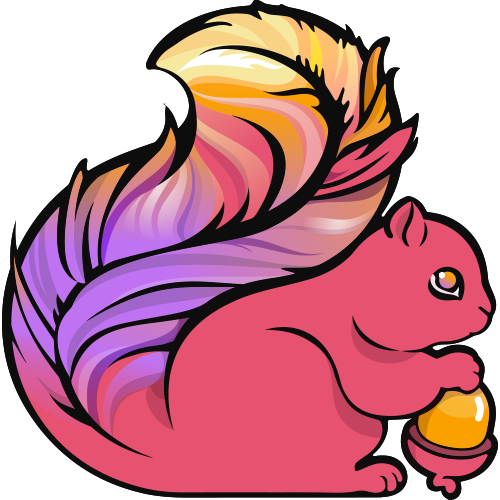

# YaLei（Pika）

**Vibe Coding 工程师**

让我们享受当下的美好.

🔭 数据库 CDC &nbsp; · &nbsp; 🌱 产品设计 &nbsp; · &nbsp; 🤖 AI is everything！

Dream Job：💻 数字游牧人

## 🛠️ 技术栈

**编程语言**

  <a href="https://www.rust-lang.org/">&nbsp;Rust</a> &nbsp;
  <a href="https://go.dev/">&nbsp;Go</a> &nbsp;
  <a href="https://www.typescriptlang.org/">&nbsp;TypeScript</a> &nbsp;
  JavaScript &nbsp;
  Java &nbsp;
  <a href="https://www.python.org/">&nbsp;Python</a> &nbsp;
  <a href="https://kotlinlang.org/"><picture><source media="(prefers-color-scheme: dark)" srcset="./profile/icons/kotlin.svg"></picture></a> &nbsp;
  Shell &nbsp;

**前端 & 后端**

  <a href="https://react.dev/"><picture><source media="(prefers-color-scheme: dark)" srcset="./profile/icons/react.svg"></picture>&nbsp;React</a> &nbsp;
  <a href="https://vuejs.org/">&nbsp;Vue</a> &nbsp;
  <a href="https://www.w3.org/html/">&nbsp;HTML5</a> &nbsp;
  <a href="https://github.com/CSS-Next/logo.css">&nbsp;CSS</a> &nbsp;
  Spring &nbsp;

**数据库 & 存储**

  MySQL &nbsp;
  <a href="https://www.postgresql.org/">&nbsp;PostgreSQL</a> &nbsp;
  SQLite &nbsp;
  SQL&nbsp;Server &nbsp;
  Oracle &nbsp;
  Redis &nbsp;
  <a href="https://www.mongodb.com/"><picture><source media="(prefers-color-scheme: dark)" srcset="./profile/icons/mongodb-dark.svg"></picture></a> &nbsp;
  DuckDB &nbsp;
  ClickHouse &nbsp;
  Elasticsearch &nbsp;
  Neo4j &nbsp;
  InfluxDB &nbsp;
  <a href="https://cassandra.apache.org/"><picture><source media="(prefers-color-scheme: dark)" srcset="./profile/icons/cassandra-dark.svg"></picture>&nbsp;Cassandra</a> &nbsp;
  DynamoDB &nbsp;
  <a href="https://firebase.google.com/">&nbsp;Firebase</a> &nbsp;
  <a href="https://supabase.com/">&nbsp;Supabase</a> &nbsp;
   &nbsp;
  达梦 &nbsp;

**消息 & 流处理**

  <a href="https://kafka.apache.org/"><picture><source media="(prefers-color-scheme: dark)" srcset="./profile/icons/kafka-dark.svg"></picture></a> &nbsp;
  RabbitMQ &nbsp;
   &nbsp;
  <a href="https://pulsar.apache.org/"><picture><source media="(prefers-color-scheme: dark)" srcset="./profile/icons/pulsar-dark.svg"></picture></a> &nbsp;
  <a href="https://flink.apache.org/">&nbsp;Flink</a> &nbsp;

**DevOps & 云原生**

  Docker &nbsp;
  Compose &nbsp;
  <a href="https://kubernetes.io/">&nbsp;Kubernetes</a> &nbsp;
  <a href="https://www.jenkins.io/">&nbsp;Jenkins</a> &nbsp;
  GitHub&nbsp;Actions &nbsp;
  Nginx &nbsp;
  Cloudflare &nbsp;
  CI/CD &nbsp;

**工具 & 构建**

  <a href="https://git-scm.com/">&nbsp;Git</a> &nbsp;
  <a href="https://www.kernel.org/">&nbsp;Linux</a> &nbsp;
  macOS &nbsp;
   &nbsp;
  <a href="https://www.vim.org/">&nbsp;Vim</a> &nbsp;
  <a href="https://brew.sh/">&nbsp;Homebrew</a> &nbsp;
  Markdown &nbsp;
  <a href="https://maven.apache.org/">&nbsp;Maven</a> &nbsp;
  Gradle &nbsp;

[图标来源与许可](./profile/icons/README.md) · MinIO is a registered trademark of the MinIO Corporation. MongoDB is a registered trademark of MongoDB, Inc.

## 📊 GitHub Stats

<picture>
  <source media="(prefers-color-scheme: dark)" srcset="./profile/github-stats-dark.svg">
  
</picture>

<!-- Public statistics refresh daily with GitHub Actions. Language usage is not a skill ranking. -->
