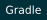

# YaLei（Pika）

**Vibe Coding 工程师**

让我们享受当下的美好.

🔭 数据库 CDC &nbsp; · &nbsp; 🌱 产品设计 &nbsp; · &nbsp; 🤖 AI is everything！

Dream Job：💻 数字游牧人

## 🛠️ 技术栈

**编程语言**

  
  
  
  
  
  
  
  

**前端 & 后端**

  
  
  
  
  

**数据库 & 存储**

  
  
  
  
  
  
  
  
  
  
  
  
  
  
  
  
  
  

**消息 & 流处理**

  
  
  
  
  

**DevOps & 云原生**

  
  
  
  
  
  
  
  

**工具 & 构建**

  
  
  
  
  
  
  
  
  

## 📊 GitHub Stats

<picture>
  <source media="(prefers-color-scheme: dark)" srcset="./profile/github-stats-dark.svg">
  
</picture>

<!-- Public statistics refresh daily with GitHub Actions. Language usage is not a skill ranking. -->
