# YaLei（Pika）

> 让我们享受当下的美好.

Dream Job：
- 💻：数字游牧人

Vibe Coding 工程师

- 🔭 ：数据库 CDC
- 🌱 ：产品设计
- 💬 ：Java、Spring、MySQL、PostgreSQL、MongoDB、Oracle、达梦
- 🤖 ：AI is everything！

## 🧩 技术栈
- **前端：** React、Vue
- **后端：** Java、Spring
- **数据库：** MySQL、PostgreSQL、Oracle、MongoDB、达梦
- **基础设施：** Docker、Compose、Linux、CI/CD  

## 📊 GitHub Stats

<picture>
  <source media="(prefers-color-scheme: dark)" srcset="./profile/stats-dark.svg">
  
</picture>
<picture>
  <source media="(prefers-color-scheme: dark)" srcset="./profile/top-langs-dark.svg">
  
</picture>

<!-- Public statistics refresh daily with GitHub Actions. Language usage is not a skill ranking. -->

## 📫 联系方式
- 邮箱：pikapi010410@gmail.com
- 主页：www.yaleizhang.com
