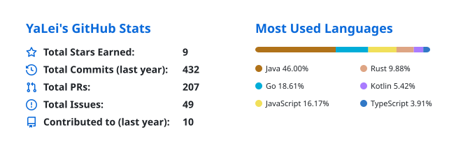

# YaLei（Pika）

**Vibe Coding 工程师**

让我们享受当下的美好.

🔭 数据库 CDC &nbsp; · &nbsp; 🌱 产品设计 &nbsp; · &nbsp; 🤖 AI is everything！

Dream Job：💻 数字游牧人

## 🛠️ 技术栈

**编程语言**

**框架 & 前端**

**数据库 & 存储**

![SQL Server](https://img.shields.io/badge/SQL%20Server-CC2927?style=flat-square&logo=data%3Aimage%2Fpng%3Bbase64%2CiVBORw0KGgoAAAANSUhEUgAAACAAAAAgCAQAAADZc7J%2FAAADJklEQVR42pWVa0zNYRzHP%2F9OdGZTSkNpU9QotEg3S8rm0guNXmSYzW1hzHVWZxMntxgzxsSMzDCXmePShd64DI3VzBSjjM0tImfSxaWvF47bcc5x%2Bj1vnst33%2F2%2B3%2Bf3ex5DuIhgsjDxhnP8N3z%2F2YlhMS0U85QxeBE%2BTut1lPOWakaThEjsKkE2vYlnABew4YOFOf8nMP7yIIor1NOEiUIWcJlArvOoKwQwkEJqGMYXwjHzmQi2U0Mtrd4SQBAr%2BIaVZNKJxEYCCYzkFWWUUkWnM9xkdd5pw04RJvqznWROUk4TvjRzhinkEcET7H%2Fh5WqUqVEWRcqiZNm0SiZZHSeJKtNehfzG%2BroUdo4G2rARSj4Z1BDNZ2AQ2YRxi8FYqaLEdR38iDt8YRfl2DlKGWtYjw97mIGNZfiTxwK6cwCzewlDtV9bNU0lQqn6JMniOMnSXMcsSSfkJzcEI1Wv4crWQq1Xqeq0Wk3KEYpV0S9MD02T1Z0H8YSSyTyesZEQVlPHEU7zhkIOsoMo7LymgWps7iQUK13fVCS0VBOEummiTqtTd1WkNJn%2FxLrKYAxh7KOQ4aQh%2FDjMOG5TwXJeeFOJBmd5wDUuUUkk7VzkFBls8badIYdKLhDMVappIp%2BH3CMYk9tuclI%2FXju1WQ26JbNQqZC%2FVuq2wuXaLacMUjlGIK08ZzeZmPAHzIThR7A3T9pU9mLhIBVYuEkBIXSwAT%2B28NVRdR4JJtDIWSCWNm4CFVTSQi5PgJ60eybwYRbnaSaSdOazhOmM4iPvWUQeFZwnlreeTVyrvkJokL6qXpsVLzRZS4RQig7pnQx3JvoCGXQngpn0I4J6PrAVOzCWAiCJIdwjHHmqg%2BkYtLCbfF4Sx3HKGUg0PZhNLh2U0I3LHl5VoT3aJ4TmO247RS90X1YFOdI8oTh3AoQhiOY6WbQTwFXSmEQvQnhGM23UcgNRymjPGaBUPdQBpStHcTLUR4dkCJkUI6uqHGa6GT8nASrQSSUIoW0KFIrRUq1UijYpwBPBn91oJpMRBCFqecxr6hBm5lDclZ8JDGJIBOx00sEAjtLiieA7r6P89S9e7EEAAAAASUVORK5CYII%3D)

**消息 & 流处理**

**开发 & 工程工具**

![VS Code](https://img.shields.io/badge/VS%20Code-20232A?style=flat-square&logo=data%3Aimage%2Fpng%3Bbase64%2CiVBORw0KGgoAAAANSUhEUgAAACAAAAAgCAYAAABzenr0AAAFFElEQVR42rVXfUyVVRj%2FnffjXpB7uQgBkRoaoVkYtu5qOkOdaH6VzdVNm7m1NXMu7wATdX4wdGWSY8Vay2qWy2z4SfPzIombNnPqGoGKKwtUEkLocj%2B473vfj6c%2FXlCIe19I8GxnZ2fvc87zez5%2Bz%2FscRkQY6sGKi7kk5flCMX3EUgsshwO1le%2B3la30RZQdagDMtY8flhl%2FoFNWFzBNQWbuTIB0PdR8u1yuu5Tf8vHilgcGwPnFJfHyX94qSaEcKAoQljA2d%2BY9AQJJbS17tas1793atvDWkALI3l4ZV%2B8VLoaZ%2FgR0AJoKSBLGzsiNKB%2B60%2FpDqL76zSEBMH7rj0m%2FBfRajXFphqUEqCoQljF2%2Bozo4ZJCHmGwyh%2FbcCq9gehXAotHtzE9VlPzLLEzBwVg9Maq8Td0%2BoUAa68PRADIWE0QEMBx3ZvMuW5riqvYNlDlacVV0xpVukIEK7r09Z7dIBB9AuAAINVdnnH9xeXNrVNcHY4NpxYzxpiZ8uRNlYuaJb066s1dljNCmykAArjEtccm%2FJ0x4QoBCSDifMkP74nZeuEbNtdtjaR8%2BHrPqjth%2Bt5QEmWCYIVWmeI9l04EMhNlrLSumRhL%2Fa8iXtWuO66dn9b25dsGXxlj9sLD2%2F0kFIABQHQnxZOS5%2FvopTIiosyDAT2qMBG42IC%2FLBI0jecy2p%2Bc9Gf8Ws8C5nSKsSv2fOeX1QLoKqDrAOl9zjBQRwpTJnaUzP%2BEuvlt6ikDGYvbdDYv6EgojcrXoM9LTQ0J4DhAtAC8ADAOYAzd3hChn0620bymovmdPc9m7vfrZu66W4jsG6sXBhKSD0T1qxIGmv4wVl4ERBHgBIDjYONYUaBkzpZIpHt8nzmAuzT0b5l%2B0N7UmAOQFjFjBQvw6DggPhGQQ4AkgSlhebjemeMvmbPZnPEmhaDn3lc670xcQ%2F0z0CBF5i0DkkcCaekQdKnG3lL7SHvpq2f6U2I2%2B1RC1tGkgvHAiAwjzpGGPRF6rJ1RXRs3ECvNRq8LElYecAbsI2shhWLQcBVQlajIdV582p8965Zt9dHc%2B%2FUA9QyBo%2BDY7A5evABe4CFYjN9p41UgLJtRyRpMGnXSWnTmA%2BZy8VGoblavDABxBRXLfLp63IgBBwgCwFsMvjdeAZNCXjNLwjGOdXzWmupE1zbH%2F3UBF5NfkdepcTvuJRoZkREEQLQqwyTfXDqyM4WXOsvN7tIE8QVv9uybw9wVzw04CQFwYQ2FvX1jnOLA19uk4Ijg7neP08UdirZ50htioONTM58SYA%2Bljjkfs6ZqNWNdGdxfDlgELgeA3PMLz%2FCZ3hLO8u98q%2FVeLElXtua4Lf729f1RS7YllfDrzp5kTpejvxxgRIS4fE9aSA1dJkYOK%2BhlqWzhUdNGZpVnqZKQuit65lNXT%2BhvHzPBmWjaRXeXYubax%2BMp8FT0WnggRSzGfWSW%2FNBIT2QAugFADmJM1rMYEID7GZblu7OVtKzz6NOSDRwAN5ieMPz5khrrzboskO6LmpgmOUA69EEBAADpqyW%2Fo%2FHncdD02316QjLvCSnk8wwaAADQ1yuaca1qPFS1%2Fm6jopNRyKJol72tFf6fDi0a0qcZm%2ByKxdT8E%2BD4HCgyIAcweuLkXk%2BzkLdlb7jmdGH7rmU3Hszj1PmOiKmL9wL0ClM68ejEKQCRHmprKg%2FUnlwV%2FDbv9gN9HRsNrIsX3EsLbSmjXhdF4YRybv%2BH%2Fxwq8kaS%2FRfSx1oIR6%2FHXwAAAABJRU5ErkJggg%3D%3D)

## 📊 GitHub Stats

<picture>
  <source media="(prefers-color-scheme: dark)" srcset="./profile/github-stats-dark.svg">
  
</picture>

<!-- Public statistics refresh daily with GitHub Actions. Language usage is not a skill ranking. -->
